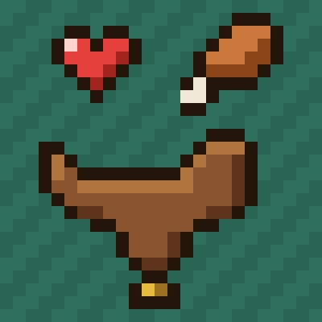

<h1 align="center">Saddle HUD</h1>

Everything about your mount in the HUD: food, health, armor, speed, jump and low health warnings

  
  
  
  
  
  

Vanilla hides your food bar while you ride and turns the experience bar into the jump bar. Saddle HUD keeps both on screen and adds what you need to know about your mount.

## Food, health and experience

- Food bar and mount health shown at the same time, with your mount's hearts one row above
- The experience bar stays visible while riding and becomes the jump bar only while you jump

## Mount armor

- Your mount's armor shown as a row of armor icons above its hearts

## Speed and jump

- Your horse's top speed and jump height next to the hotbar: green is great, yellow is average, red is poor

## Low health warning

- Your mount's hearts blink and a sound plays below 30% health

## Every mount

- Works with horses, donkeys, mules, llamas, camels, pigs, striders and every rideable mob

## Client side

Install it only on your game: it changes the HUD and works on any server.

## Configuration

Every feature can be toggled in the mod config: food while mounted, experience bar until jump, mount armor, mount speed and jump, and the low health warning.

## Dependencies

<strong>Fabric/Quilt:</strong>

- <a href="https://modrinth.com/mod/fabric-api">Fabric API</a>
- <a href="https://modrinth.com/mod/modmenu">Mod Menu</a> <strong>(Optional)</strong>

  
More screenshots

